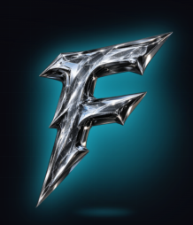
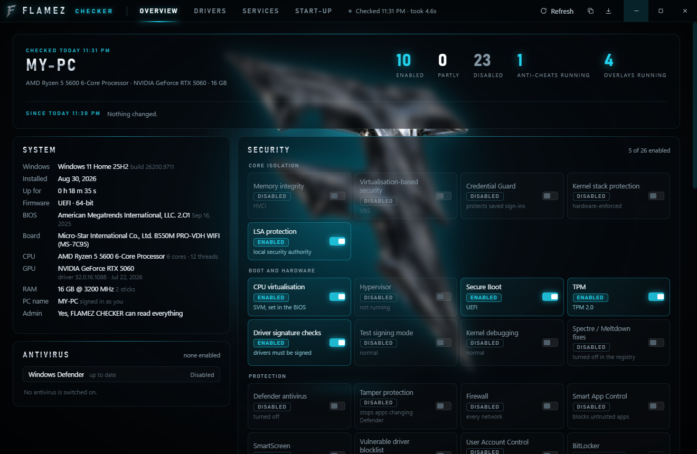
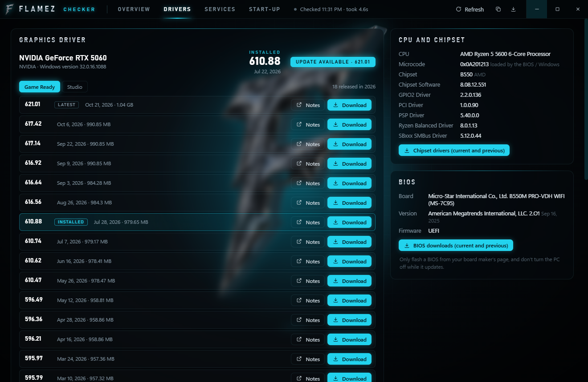
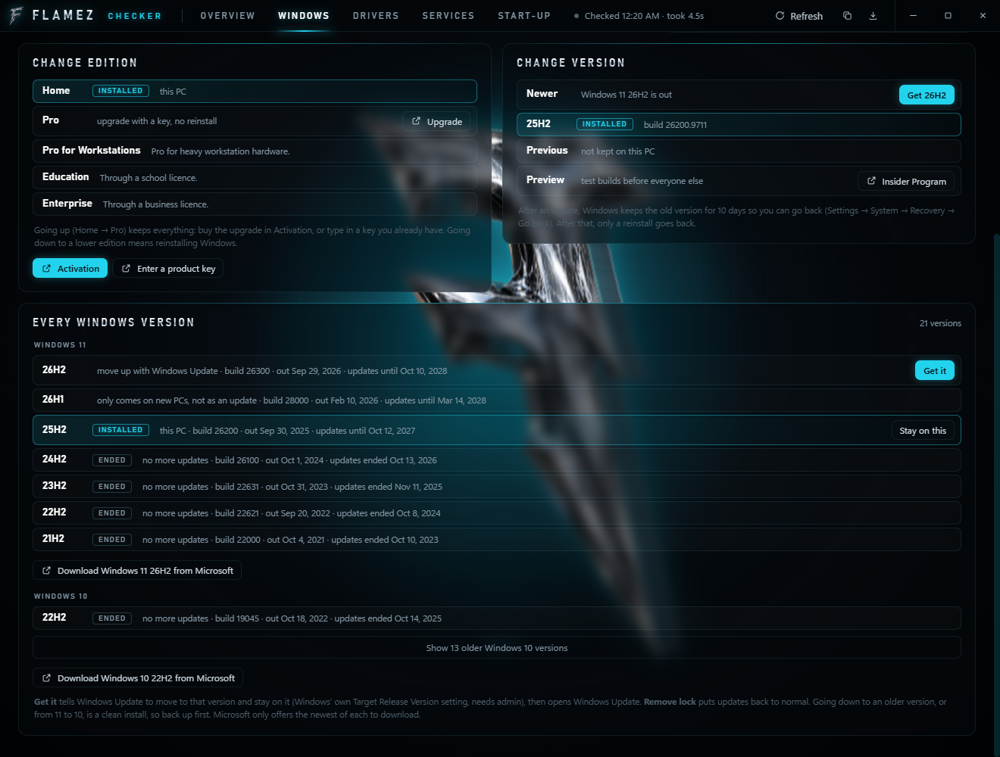

<p align="center"></p>

<h1 align="center">FLAMEZ CHECKER</h1>

<p align="center">See everything that's turned on and off on your Windows PC, and get the right drivers, in one place.</p>

<p align="center"><a href="https://github.com/Acuz3D/flamez-checker/releases/latest"><b>⬇ Download the latest version</b></a></p>



## What it shows

- **Security**: memory integrity (HVCI), VBS, Credential Guard, Secure Boot, TPM, Defender, tamper protection, firewall, Smart App Control, SmartScreen, the vulnerable driver blocklist, UAC, BitLocker, test signing, Hyper-V, WSL and more, each marked **Enabled** or **Disabled**
- **Gaming and Windows**: Game Mode, GPU scheduling, windowed game optimisations, Game Bar recording, mouse acceleration, fast startup, power plan
- **What's installed and running**: anti-cheats (Easy Anti-Cheat, BattlEye, Vanguard, FACEIT, Ubisoft…), game launchers, overlays and recording apps, debug tools
- **Your PC**: Windows version, BIOS, board, CPU, GPU, RAM, disks, monitors, network
- **Changes since last check**: anything that got switched on or off since you last opened it is listed at the top
- **Services** and **Start-up apps**, with search and filters
- Click any setting to open the Windows page where you change it. Copy or save a text report to share

## Drivers



- Your graphics driver, and whether a newer one is out
- **NVIDIA:** every Game Ready and Studio driver from this year (and older), each with a **Download** button straight from NVIDIA and its release notes
- Older drivers Windows still keeps on your PC, with a shortcut to roll back
- CPU microcode, chipset and chipset software, with a link to the chipset drivers
- BIOS version with a link to your board maker's BIOS downloads
- Sound, network, Bluetooth and storage drivers with their versions

## Windows



- Your edition, version, build and whether Windows is activated
- **Change edition**: upgrade Home to Pro with a key, or open Activation
- **Change version**: Windows Update, go back to the previous version (while Windows still keeps it), or join the Insider Program
- **Every Windows version**: all of Windows 11 (21H2 to 26H2) and Windows 10 (1507 to 22H2) with their build, release date and how long they get updates. **Get it** moves this PC up to a newer version with Windows Update and keeps it there; **Stay on this** holds your current one; **Remove lock** puts updates back to normal
- **Install Windows 11 or 10** straight from Microsoft, and see whether this PC is ready for Windows 11

## Anti-cheats

Each anti-cheat with an uninstaller has an **Uninstall** button. It asks first, then opens that anti-cheat's own uninstaller.

FLAMEZ CHECKER only **reads** your settings. It never changes anything by itself; clicking a setting just opens the right Windows page, and uninstalling only happens when you press Uninstall and confirm.

## Updates

FLAMEZ CHECKER updates itself. New versions download in the background from the GitHub releases, and a **Restart to update** button appears when one is ready (it also installs the next time you close the app).

## Install

1. Download `FLAMEZ-CHECKER-Setup-x.x.x.exe` from [Releases](https://github.com/Acuz3D/flamez-checker/releases/latest)
2. Run it. It installs and opens straight away, and adds a shortcut to your Desktop and Start menu
3. Windows may say *"Windows protected your PC"* because the installer isn't signed with a paid certificate. Click **More info → Run anyway**

Windows 10 or 11, 64-bit. Running it as administrator lets it read a few more settings.

## Build it yourself

```
npm install
npm start          # run it
npm run dist       # build the installer into dist/
```
